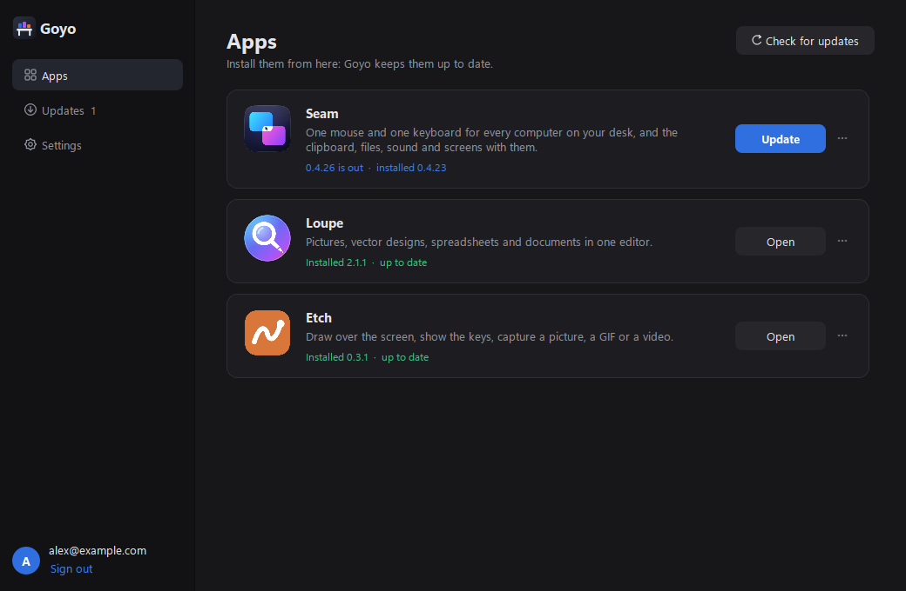
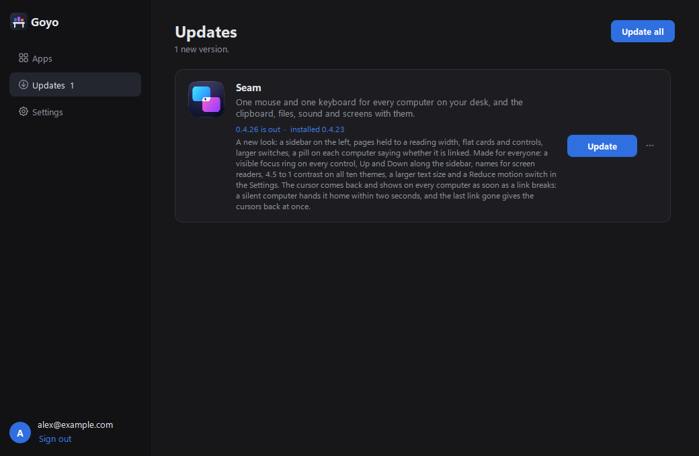

# Goyo

**Every app, one account, always up to date.**

[**Download for Windows**](../../releases/latest) &nbsp;·&nbsp; [Releases](../../releases)

 

Goyo installs Seam, Loupe and Etch from one window and keeps them up to date. Sign in once with your account, the
same one Seam uses, and every app is a click away.

## What it does

- **Install** any app with one click: Goyo downloads its installer, checks it is exactly the one published, and runs
  it for your account, no administrator needed.
- **Updates by themselves.** Goyo waits in the notification area and looks for new versions every hour. They install
  on their own (Settings), or wait for you on the **Updates** page with what each one brings, and **Update all**.
- **Never in your way.** An app that can restart itself (Seam, Etch) is updated while it runs and comes back; an app
  that might hold an unsaved document (Loupe) is updated once you close it.
- **Open, uninstall, see what is new** from each app's card.
- **Goyo updates itself** the same way.

## Install

1. Download `GoyoSetup-<version>.exe` from the [latest release](../../releases/latest) and run it. It installs for
   your account and starts with Windows in the notification area (a box in the installer).
2. Windows may say *Windows protected your PC*: click **More info**, then **Run anyway** (Goyo is not signed yet).
3. Sign in with your account, or create one from the sign-in page.

Windows 10 or 11, 64-bit. Settings and log live in `%APPDATA%\Goyo`.

---

(c) 2026 Gregoire Dehame. All rights reserved.

